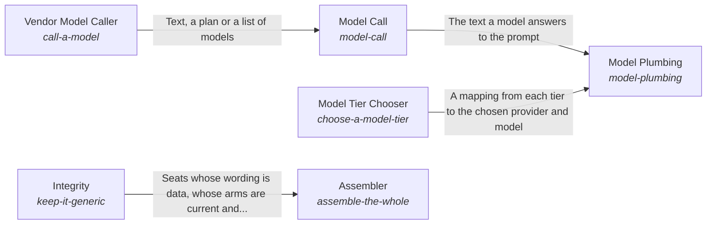

These are ESOI records rendered as a diagram (evolvable structure that optimizes intent). This page is generated from the solutions' outputs and the implementations' `uses_solution_ids` by `esoi diagram`; edit those records, not this page.

# Solution diagram: The parts working as one whole

The Self keeps the parts of the system working as one whole, and Role Understanding states what each part is for so that no part does another's work. The Assembler builds the whole from configuration in one call and asks Integrity whether the hub still stays generic, with claims that match evidence and records that match code. Model Plumbing is how every part asks a model, and it picks the model for each tier through Model Tier Chooser and asks that model through Model Call. Model Call reaches each vendor through Vendor Model Caller, which steps to the next provider when one fails.

An arrow runs from the solution that provides to the solution that builds on it; its label is what the provider outputs.

