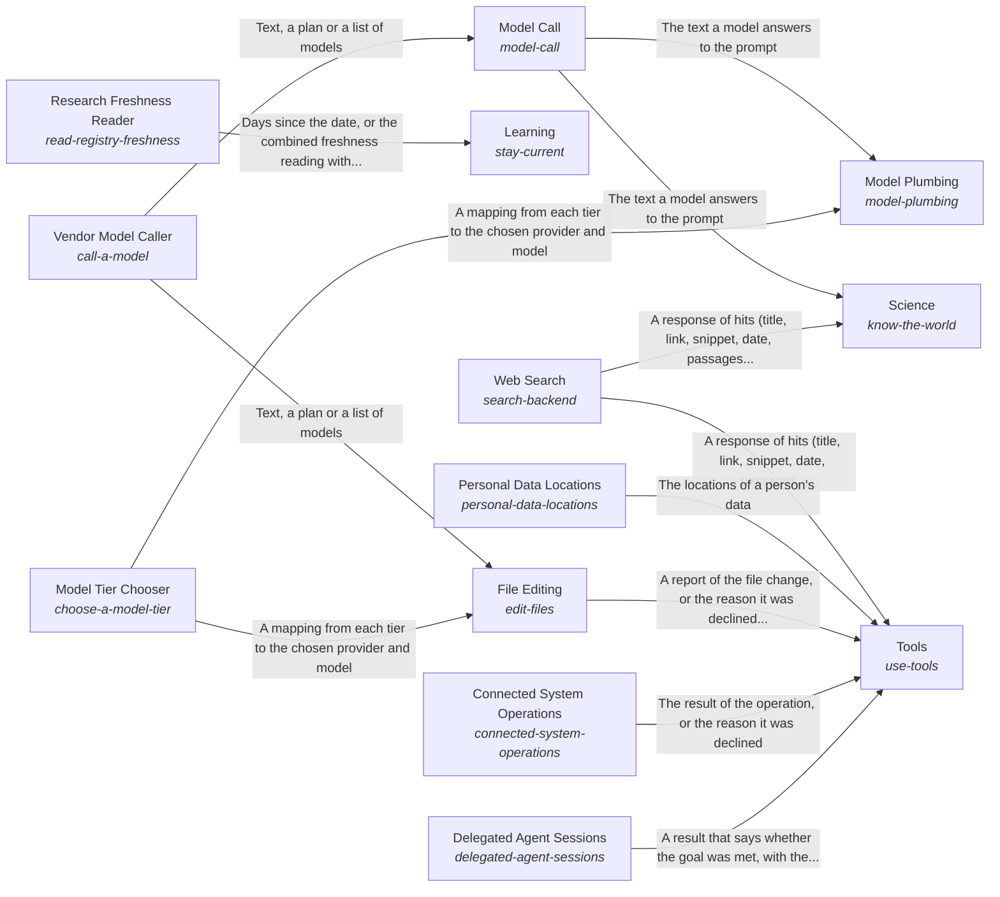

# Awareness of the outside and interaction with it

The AI knows what is outside the system and can interact with it: it brings in knowledge a reader can check, uses the right tool for each kind of need, asks a model through one measured path and keeps its own research current.

*ESOI records of this intent (evolvable structure that optimizes intent), generated from the CSV files beside this page by `esoi readmes`. Edit the CSV files, not this page.*

This sub-intent arises as the implementation `take-in-the-world:composition` of its parent intent [`hub-of-hubs`](../../esoi/README.md). Opportunities: Tool categories as solutions, with integrations as their implementations, go beyond bringing in a web search, and a category can gain a better integration without any product rewriting its code. The models the hub asks and the freshness of its research change with the outside too.

## How the solutions fit together

World is how the system learns what is outside it and acts on it. Science returns observations of public research that a reader can cite. Tools lets the AI use the tool of a category through Web Search, File Editing, Connected System Operations, Delegated Agent Sessions or Personal Data Locations. File Editing makes its one-call edit through Vendor Model Caller at the tier that Model Tier Chooser picks. Model Plumbing is how every part asks a model, and it picks the model for each tier through Model Tier Chooser and asks that model through Model Call. Model Call reaches each vendor through Vendor Model Caller, which steps to the next provider when one fails. Learning keeps the research current by reading dates through Research Freshness Reader.

## Diagram

An arrow runs from the solution that provides to the solution that builds on it; its label is what the provider outputs.

## Solutions at a glance

| Solution | Handle | Entry call | Selected implementation | Metric |
|---|---|---|---|---|
| Model Call | `model-call` | `hubofhubs.run("model-call", ...)` | Built on the vendor model caller (`via_call_a_model`) | Model call answers for the tier |
| Vendor Model Caller | `call-a-model` | `hubofhubs.run("call-a-model", ...)` | Claude Code CLI (`claude_cli`) | Provider failover |
| Model Tier Chooser | `choose-a-model-tier` | `hubofhubs.run("choose-a-model-tier", {'available': ['anthropic']})` | Passing work per cost selector (`tier_selector`) | Tier choice by passing work per cost, Tier passing work per cost, Model quality on hard maths, Vendor arms answer |
| Model Plumbing | `model-plumbing` | `hubofhubs.run("model-plumbing", ...)` | Answers through the measured model for the tier (`composition`) | Every part asks a model through one path |
| Learning | `stay-current` | `hubofhubs.run("stay-current", '2026-11-03')` | Stale areas from the registry dates (`registry_research`) | Days since each seat was researched, Public stage sourced and triangulated, Best in circumstance with variants |
| Research Freshness Reader | `read-registry-freshness` | `hubofhubs.run("read-registry-freshness", '2026-10-01')` | Registry date scan (`registry_scan`) | Registry freshness reading |
| Science | `know-the-world` | `hubofhubs.run("know-the-world", 'meditation and attention')` | OpenAlex semantic search (`openalex_semantic`) | Research question finds its paper |
| Web Search | `search-backend` | `hubofhubs.run("search-backend", 'latest Rust release')` | Gemini grounding (`gemini`) | Search finds the source |
| Tools | `use-tools` | `hubofhubs.run("use-tools", ...)` | Categories of tools (`composition`) | The best integration of each category is chosen, Share of connections that need no code, Share of connections that need no code |
| Personal Data Locations | `personal-data-locations` | `hubofhubs.run("personal-data-locations", '')` | none selected | A location is declared once and found by every tool |
| File Editing | `edit-files` | `hubofhubs.run("edit-files", ...)` | One-call file edit (`fast_edit`) | Goal met by its own tests |
| Connected System Operations | `connected-system-operations` | `hubofhubs.run("connected-system-operations", ...)` | none selected | The operation is carried out and nothing else |
| Delegated Agent Sessions | `delegated-agent-sessions` | `hubofhubs.run("delegated-agent-sessions", ...)` | Claude Code, steerable session (`stream_json_goal_runner`) | Harness, context, sub-agents and recursion ranked, Goal met by its own tests (agent sessions) |

## Problems and ideals

**Problems**

- Each part that needs a model chooses and calls it its own way, so tier choice, cost and failover are repeated and drift apart. (`hprob-every-part-picks-its-own-model`)
- One public benchmark is trusted alone to rank parts, although it may measure a different task, be saturated or leaked into training data, and its source is rarely checked. (`hprob-public-evals-relied-on-singly`)
- A part is ranked best overall, but which part is best depends on the circumstance (a cost limit, a speed limit, a language, the size of the input), so the single winner is wrong for many users. (`hprob-one-best-pick-ignores-circumstance`)
- An agent harness used on a flat subscription is slow and spends more tokens than the work needs, partly because the context it is given is poor and partly because it repeats work through sub-agents... (`hprob-harness-dear-and-slow-on-the-subscription`)
- Each product wires its own integrations and finds a person's data its own way, so a new kind of integration means new code and a person's data locations are asked for again by every product. (`hprob-each-product-wires-its-own-tools`)
- A factual or research answer cites a web page instead of the papers and data that bear on it, so the reader cannot check it. (`hprob-claims-without-checkable-sources`)
- A change to one file is routed to an agent session that costs and takes far more than the edit needs, or is hand-written for each product. (`hprob-small-edits-pay-for-an-agent`)
- Every connected system's operations are wired into each product by hand. (`hprob-each-system-operation-is-wired-by-hand`)
- How old each area's research is has to be worked out by hand, so stale recommendations go unnoticed. (`hprob-research-dates-are-read-by-hand`)

**Ideals**

- Tools chosen by category (`hideal-tools-chosen-by-category`): For each category of tool, the best integration is chosen by measurement, and a person's data locations are declared once.

## Metrics and their leaders

- Tier choice by passing work per cost (`metric-choose-a-model-tier`): leader `tier_selector`, 36 of 36 cases
- Tier passing work per cost (`metric-tier-passing-work-per-cost`)
- Model quality on hard maths (`metric-model-quality`): leader `deepseek_v4_pro`, 3 of 3 cases
- Vendor arms answer (`metric-vendor-answers`): leader `claude_cli`, 3 of 3 cases
- Model call answers for the tier (`metric-model-call`): leader `via_call_a_model`, 30 of 30 cases
- Provider failover (`metric-call-a-model`): leader `multi_provider`, 30 of 30 cases
- Every part asks a model through one path (`metric-model-plumbing`)
- Days since each seat was researched (`metric-stay-current`)
- Registry freshness reading (`metric-read-registry-freshness`): leader `registry_scan`, 41 of 41 cases
- Public stage sourced and triangulated (`metric-public-stage-sourced-and-triangulated`)
- and 10 more: all 20 are in [metrics](#metrics) of the full record below

## Where to go next

- Parent intent: [The best parts for AI intelligence, assembled and proven](../../esoi/README.md)
- Repository: [top README](../../README.md)
- Records: [intent.csv](intent.csv), [problems.csv](problems.csv), [ideals.csv](ideals.csv), [solutions.csv](solutions.csv), [implementations.csv](implementations.csv), [metrics.csv](metrics.csv)
- Diagram page: [diagram.md](diagram.md)

---

## The full record

### Problems

- Each part that needs a model chooses and calls it its own way, so tier choice, cost and failover are repeated and drift apart. (`hprob-every-part-picks-its-own-model`)
- One public benchmark is trusted alone to rank parts, although it may measure a different task, be saturated or leaked into training data, and its source is rarely checked. (`hprob-public-evals-relied-on-singly`)
- A part is ranked best overall, but which part is best depends on the circumstance (a cost limit, a speed limit, a language, the size of the input), so the single winner is wrong for many users. (`hprob-one-best-pick-ignores-circumstance`)
- An agent harness used on a flat subscription is slow and spends more tokens than the work needs, partly because the context it is given is poor and partly because it repeats work through sub-agents and recursion. (`hprob-harness-dear-and-slow-on-the-subscription`)
- Each product wires its own integrations and finds a person's data its own way, so a new kind of integration means new code and a person's data locations are asked for again by every product. (`hprob-each-product-wires-its-own-tools`)
- A factual or research answer cites a web page instead of the papers and data that bear on it, so the reader cannot check it. (`hprob-claims-without-checkable-sources`)
- A change to one file is routed to an agent session that costs and takes far more than the edit needs, or is hand-written for each product. (`hprob-small-edits-pay-for-an-agent`)
- Every connected system's operations are wired into each product by hand. (`hprob-each-system-operation-is-wired-by-hand`)
- How old each area's research is has to be worked out by hand, so stale recommendations go unnoticed. (`hprob-research-dates-are-read-by-hand`)

### Ideals

- Tools chosen by category (`hideal-tools-chosen-by-category`): For each category of tool, the best integration is chosen by measurement, and a person's data locations are declared once.

### Solutions

| Solution | Handle | Selected | Metric |
|---|---|---|---|
| Model Call | `model-call` | Built on the vendor model caller (`via_call_a_model`) | Model call answers for the tier |
| Vendor Model Caller | `call-a-model` | Claude Code CLI (`claude_cli`) | Provider failover |
| Model Tier Chooser | `choose-a-model-tier` | Passing work per cost selector (`tier_selector`) | Tier choice by passing work per cost, Tier passing work per cost, Model quality on hard maths, Vendor arms answer |
| Model Plumbing | `model-plumbing` | Answers through the measured model for the tier (`composition`) | Every part asks a model through one path |
| Learning | `stay-current` | Stale areas from the registry dates (`registry_research`) | Days since each seat was researched, Public stage sourced and triangulated, Best in circumstance with variants |
| Research Freshness Reader | `read-registry-freshness` | Registry date scan (`registry_scan`) | Registry freshness reading |
| Science | `know-the-world` | OpenAlex semantic search (`openalex_semantic`) | Research question finds its paper |
| Web Search | `search-backend` | Gemini grounding (`gemini`) | Search finds the source |
| Tools | `use-tools` | Categories of tools (`composition`) | The best integration of each category is chosen, Share of connections that need no code, Share of connections that need no code |
| Personal Data Locations | `personal-data-locations` | none selected | A location is declared once and found by every tool |
| File Editing | `edit-files` | One-call file edit (`fast_edit`) | Goal met by its own tests |
| Connected System Operations | `connected-system-operations` | none selected | The operation is carried out and nothing else |
| Delegated Agent Sessions | `delegated-agent-sessions` | Claude Code, steerable session (`stream_json_goal_runner`) | Harness, context, sub-agents and recursion ranked, Goal met by its own tests (agent sessions) |

### Implementations

| Implementation | Handle | Where | Sub-intent |
|---|---|---|---|
| Passing work per cost selector | `choose-a-model-tier:tier_selector` | [hubofhubs/tiers.py](../tiers.py) |  |
| Anthropic provider | `call-a-model:anthropic` | [hubofhubs/models/anthropic.py](../models/anthropic.py) |  |
| DeepSeek provider | `call-a-model:deepseek` | [hubofhubs/models/openai.py](../models/openai.py) |  |
| Gemini provider | `call-a-model:gemini` | [hubofhubs/models/gemini.py](../models/gemini.py) |  |
| Multi-provider router | `call-a-model:multi_provider` | [hubofhubs/models/router.py](../models/router.py) |  |
| OpenAI provider | `call-a-model:openai` | [hubofhubs/models/openai.py](../models/openai.py) |  |
| Built on the vendor model caller | `model-call:via_call_a_model` | [hubofhubs/models/via_provider.py](../models/via_provider.py) |  |
| Claude Code CLI | `call-a-model:claude_cli` | [hubofhubs/models/claude_cli.py](../models/claude_cli.py) |  |
| Answers through the measured model for the tier | `model-plumbing:composition` | [hubofhubs/areas.py](../areas.py) |  |
| One-call file edit | `edit-files:fast_edit` | [hubofhubs/act/fast_edit.py](../act/fast_edit.py) |  |
| One-call MCP write | `connected-system-operations:mcp_operations` | [hubofhubs/act/mcp_operations.py](../act/mcp_operations.py) |  |
| Claude Code, one shot | `delegated-agent-sessions:subprocess_goal_runner` | [hubofhubs/deep/subprocess_runner.py](../deep/subprocess_runner.py) |  |
| Claude Code, steerable session | `delegated-agent-sessions:stream_json_goal_runner` | [hubofhubs/deep/stream_runner.py](../deep/stream_runner.py) |  |
| Agent Client Protocol runner | `delegated-agent-sessions:acp_deep_runner` | [hubofhubs/deep/acp_runner.py](../deep/acp_runner.py) |  |
| Registry date scan | `read-registry-freshness:registry_scan` | [hubofhubs/registry.py](../registry.py) |  |
| Stale areas from the registry dates | `stay-current:registry_research` | [hubofhubs/areas.py](../areas.py) |  |
| OpenAlex keyword search | `know-the-world:openalex` | [hubofhubs/science/openalex.py](../science/openalex.py) |  |
| OpenAlex semantic search | `know-the-world:openalex_semantic` | [hubofhubs/science/openalex_semantic.py](../science/openalex_semantic.py) |  |
| OpenAlex keywords, rule rewrite | `know-the-world:openalex_keywords` | [hubofhubs/science/openalex_keywords.py](../science/openalex_keywords.py) |  |
| OpenAlex keywords, model rewrite | `know-the-world:openalex_keywords_model` | [hubofhubs/science/openalex_keywords.py](../science/openalex_keywords.py) |  |
| Semantic and web paper search | `know-the-world:openalex_semantic_and_web` | [hubofhubs/science/openalex_semantic_and_web.py](../science/openalex_semantic_and_web.py) |  |
| Brave Search API | `search-backend:brave` | [hubofhubs/websearch/backends.py](../websearch/backends.py) |  |
| Gemini grounding | `search-backend:gemini` | [hubofhubs/websearch/gemini.py](../websearch/gemini.py) |  |
| Provider-native search | `search-backend:provider` | [hubofhubs/websearch/backends.py](../websearch/backends.py) |  |
| SearXNG metasearch | `search-backend:searxng` | [hubofhubs/websearch/backends.py](../websearch/backends.py) |  |
| Serper Google search | `search-backend:serper` | [hubofhubs/websearch/backends.py](../websearch/backends.py) |  |
| Tavily search API | `search-backend:tavily` | [hubofhubs/websearch/backends.py](../websearch/backends.py) |  |
| Web research | `know-the-world:web_research` | [hubofhubs/websearch/research.py](../websearch/research.py) |  |
| Categories of tools | `use-tools:composition` | [hubofhubs/flows.py](../flows.py) |  |

### Metrics

- Tier choice by passing work per cost (`metric-choose-a-model-tier`): `esoi run reason_and_answer --impl tier_selector`
- Tier passing work per cost (`metric-tier-passing-work-per-cost`): `python3 -m pytest tests/test_tiers.py`
- Model quality on hard maths (`metric-model-quality`): `esoi run model_quality_aime --impl claude_haiku; esoi run model_quality_aime --impl claude_sonnet; esoi run model_quality_aime --impl claude_opus; esoi run model_quality_aime --impl gemini_2_5_flash_lite; esoi run model_quality_aime --impl gemini_2_5_flash; esoi run model_quality_aime --impl gpt_5_nano; esoi run model_quality_aime --impl gpt_5_mini; esoi run model_quality_aime --impl deepseek_flash`
- Vendor arms answer (`metric-vendor-answers`): `esoi run call_a_model --impl gemini; esoi run call_a_model --impl openai; esoi run call_a_model --impl deepseek; esoi run call_a_model --impl claude_cli`
- Model call answers for the tier (`metric-model-call`): `esoi run model_call --impl via_call_a_model`
- Provider failover (`metric-call-a-model`): `esoi run provider_failover --impl multi_provider`
- Every part asks a model through one path (`metric-model-plumbing`): `none`
- Days since each seat was researched (`metric-stay-current`): `none`
- Registry freshness reading (`metric-read-registry-freshness`): `esoi run stay_current --impl registry_scan`
- Public stage sourced and triangulated (`metric-public-stage-sourced-and-triangulated`): `none`
- Best in circumstance with variants (`metric-best-in-circumstance-with-variants`): `none`
- Harness, context, sub-agents and recursion ranked (`metric-harness-context-subagents-recursion-ranked`): `python3 -m pytest tests/test_deep_session_subagents.py`
- Research question finds its paper (`metric-know-the-world`): `esoi run know_the_world --impl openalex_semantic_and_web; esoi run know_the_world --impl openalex_semantic; esoi run know_the_world --impl web_research; esoi run know_the_world --impl openalex; esoi run know_the_world --impl openalex_keywords; esoi run know_the_world --impl openalex_keywords_model`
- Search finds the source (`metric-search-backend`): `esoi run search_backend --impl gemini; esoi run search_backend --impl provider; esoi run search_backend --impl searxng; esoi run search_backend --impl brave; esoi run search_backend --impl serper; esoi run search_backend --impl tavily`
- The best integration of each category is chosen (`metric-use-tools`): `none`
- A location is declared once and found by every tool (`metric-personal-data-locations`): `none`
- Goal met by its own tests (`metric-edit-files`): `esoi run file_edit_goals --impl fast_edit; esoi run file_edit_goals --impl none`
- Goal met by its own tests (agent sessions) (`metric-delegated-agent-sessions`): `esoi run file_edit_goals --impl subprocess_goal_runner; esoi run file_edit_goals --impl stream_json_goal_runner; esoi run file_edit_goals --impl acp_deep_runner; esoi run file_edit_goals --impl none`
- Share of connections that need no code (`metric-connection-config-share`): `python3 -m pytest tests/test_registry.py tests/test_areas.py`
- The operation is carried out and nothing else (`metric-connected-system-operations`): `none`
