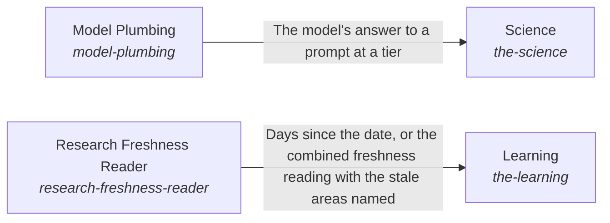

# Awareness of the outside and interaction with it

The AI system optimally learns and interacts with the world outside of it.

*ESOI records of this intent (evolvable structure that optimizes intent), generated from the CSV files beside this page by `esoi readmes`. Edit the CSV files, not this page.*

This sub-intent arises as the implementation `the-world:composition` of its parent intent [`hub-of-hubs`](../../esoi/README.md). Opportunities: Tool categories as solutions, with integrations as their implementations, go beyond bringing in a web search, and a category can gain a better integration without any product rewriting its code. The models the hub asks and the freshness of its research change with the outside too.

## How the solutions fit together

World is how the system learns what is outside it and acts on it. Science returns observations of public research that a reader can cite. Tools lets the AI use the tool of a category through Web Search, File Reading, File Editing, Connected System Operations or Delegated Agent Sessions, and refuses a category the authority does not allow. File Editing makes its one-call edit through Vendor Model Caller at the tier that Model Tier Chooser picks. Model Plumbing is how every part asks a model, through Model Tier Chooser and Vendor Model Caller. Vendor Model Caller steps to the next provider when one fails. Learning keeps the research current by reading dates through Research Freshness Reader.

## Diagram

An arrow runs from the solution that provides to the solution that builds on it; its label is what the provider outputs.

## Solutions at a glance

| Solution | Handle | Entry call | Selected implementation | Metric |
|---|---|---|---|---|
| Model Plumbing | `model-plumbing` | `hubofhubs.run("model-plumbing", ...)` | Tier chooser then vendor (`via_vendor`) | Model asked at the tier, within the budget |
| Science | `the-science` | `hubofhubs.run("the-science", 'meditation and attention')` | OpenAlex semantic search (`openalex_semantic`) | Research question finds its paper |
| Tools | `the-tools` | `hubofhubs.run("the-tools", ...)` | Categories of tools (`composition`) | The best integration of each category is chosen, Share of connections that need no code, Integration added with zero code, Integration served by combined hubs, Integration available within the weekly refresh, Integration credentials stay with their user |
| Learning | `the-learning` | `hubofhubs.run("the-learning", '2026-11-03')` | Stale areas from the registry dates (`registry_research`) | Days since each seat was researched, Public stage sourced and triangulated, Best in circumstance with variants |
| Research Freshness Reader | `research-freshness-reader` | `hubofhubs.run("research-freshness-reader", '2026-10-01')` | Registry date scan (`registry_scan`) | Registry freshness reading |

## Problems and ideals

**Problems**

- One public benchmark trusted alone (`hprob-public-evals-relied-on-singly`): One public benchmark is trusted alone to rank parts, although it may measure a different task, be saturated or leaked into training data, and its source is rarely checked.
- Best pick ignores circumstance (`hprob-one-best-pick-ignores-circumstance`): A part is ranked best overall, but which part is best depends on the circumstance (a cost limit, a speed limit, a language, the size of the input), so the single winner can be wrong for many users.
- Agent harness costly and slow on a subscription (`hprob-harness-dear-and-slow-on-the-subscription`): An agent harness used on a flat subscription is slow and spends more tokens than the work needs, partly because the context it is given is poor and partly because it repeats work through sub-agents and recursion.
- Claims without checkable sources (`hprob-claims-without-checkable-sources`): A factual or research answer often cites a web page, or nothing, instead of the papers and data that bear on it, so the reader cannot check it.
- The outside is wired into each part by hand (`hprob-the-outside-is-wired-into-each-part-by-hand`): Each part that needs a model or a tool is wired to one vendor or one integration directly, so a better model or tool outside the system cannot be adopted without rewriting parts.
- Research dates read by hand (`hprob-research-dates-are-read-by-hand`): How old each area's research is has to be worked out by hand, so stale recommendations go unnoticed.

**Ideals**

- The best tool for each kind of task (`hideal-tools-chosen-by-category`): For every kind of task, the AI uses the best tool available to it, and a person says where their data lives only once.
- The best of the outside is in use (`hideal-the-outside-is-adopted-by-measurement`): A better model or tool outside the system is adopted because it measured better, with no part rewritten.

## Metrics and their leaders

- Model asked at the tier, within the budget (`metric-model-plumbing`): leader `via_vendor`, 30 of 30 cases
- Research question finds its paper (`metric-the-science`): leader `openalex_semantic`, 52 of 150 cases
- The best integration of each category is chosen (`metric-the-tools`)
- Days since each seat was researched (`metric-the-learning`)
- Public stage sourced and triangulated (`metric-public-stage-sourced-and-triangulated`)
- Best in circumstance with variants (`metric-best-in-circumstance-with-variants`)
- Registry freshness reading (`metric-research-freshness-reader`): leader `registry_scan`, 41 of 41 cases

## Where to go next

- Sub-intent: [Asking a model through one measured path](model_plumbing/README.md) (Every part asks a model through one path: the tier is chosen by measurement and the vendor behind it can change without any part noticing.)
- Sub-intent: [Using the tools of the outside world](tools/README.md) (The AI uses the tool of each category the person's authority allows, and a category gains a better integration without any product rewriting its code.)
- Parent intent: [The best parts for AI intelligence, assembled and proven](../../esoi/README.md)
- Repository: [top README](../../README.md)
- Records beside the code: [hubofhubs/the_world/learning](learning/README.md), [hubofhubs/the_world/science](science/README.md), [hubofhubs/the_world/learning/research_freshness_reader](learning/research_freshness_reader/README.md)
- Records: [intent.csv](intent.csv), [problems.csv](problems.csv), [ideals.csv](ideals.csv), [solutions.csv](solutions.csv), [implementations.csv](implementations.csv), [metrics.csv](metrics.csv)
- Diagram page: [diagram.md](diagram.md)

---

## The full record

### Problems

- One public benchmark trusted alone (`hprob-public-evals-relied-on-singly`): One public benchmark is trusted alone to rank parts, although it may measure a different task, be saturated or leaked into training data, and its source is rarely checked.
- Best pick ignores circumstance (`hprob-one-best-pick-ignores-circumstance`): A part is ranked best overall, but which part is best depends on the circumstance (a cost limit, a speed limit, a language, the size of the input), so the single winner can be wrong for many users.
- Agent harness costly and slow on a subscription (`hprob-harness-dear-and-slow-on-the-subscription`): An agent harness used on a flat subscription is slow and spends more tokens than the work needs, partly because the context it is given is poor and partly because it repeats work through sub-agents and recursion.
- Claims without checkable sources (`hprob-claims-without-checkable-sources`): A factual or research answer often cites a web page, or nothing, instead of the papers and data that bear on it, so the reader cannot check it.
- The outside is wired into each part by hand (`hprob-the-outside-is-wired-into-each-part-by-hand`): Each part that needs a model or a tool is wired to one vendor or one integration directly, so a better model or tool outside the system cannot be adopted without rewriting parts.
- Research dates read by hand (`hprob-research-dates-are-read-by-hand`): How old each area's research is has to be worked out by hand, so stale recommendations go unnoticed.

### Ideals

- The best tool for each kind of task (`hideal-tools-chosen-by-category`): For every kind of task, the AI uses the best tool available to it, and a person says where their data lives only once.
- The best of the outside is in use (`hideal-the-outside-is-adopted-by-measurement`): A better model or tool outside the system is adopted because it measured better, with no part rewritten.

### Solutions

| Solution | Handle | Selected | Metric |
|---|---|---|---|
| Model Plumbing | `model-plumbing` | Tier chooser then vendor (`via_vendor`) | Model asked at the tier, within the budget |
| Science | `the-science` | OpenAlex semantic search (`openalex_semantic`) | Research question finds its paper |
| Tools | `the-tools` | Categories of tools (`composition`) | The best integration of each category is chosen, Share of connections that need no code, Integration added with zero code, Integration served by combined hubs, Integration available within the weekly refresh, Integration credentials stay with their user |
| Learning | `the-learning` | Stale areas from the registry dates (`registry_research`) | Days since each seat was researched, Public stage sourced and triangulated, Best in circumstance with variants |
| Research Freshness Reader | `research-freshness-reader` | Registry date scan (`registry_scan`) | Registry freshness reading |

### Implementations

| Implementation | Handle | Where | Sub-intent |
|---|---|---|---|
| Web research | `the-science:web_research` | [hubofhubs/the_world/tools/web_search/research.py](tools/web_search/research.py) |  |
| Categories of tools | `the-tools:composition` | [hubofhubs/the_world/tools/flow.py](tools/flow.py) | [tools](tools/README.md) |
| Tier chooser then vendor | `model-plumbing:via_vendor` | [hubofhubs/the_world/model_plumbing/via_vendor.py](model_plumbing/via_vendor.py) | [model_plumbing](model_plumbing/README.md) |
| Stale areas from the registry dates | `the-learning:registry_research` | [hubofhubs/the_world/learning/registry_research.py](learning/registry_research.py) |  |
| OpenAlex keyword search | `the-science:openalex` | [hubofhubs/the_world/science/openalex.py](science/openalex.py) |  |
| OpenAlex semantic search | `the-science:openalex_semantic` | [hubofhubs/the_world/science/openalex_semantic.py](science/openalex_semantic.py) |  |
| OpenAlex keywords, rule rewrite | `the-science:openalex_keywords` | [hubofhubs/the_world/science/openalex_keywords.py](science/openalex_keywords.py) |  |
| OpenAlex keywords, model rewrite | `the-science:openalex_keywords_model` | [hubofhubs/the_world/science/openalex_keywords.py](science/openalex_keywords.py) |  |
| Semantic and web paper search | `the-science:openalex_semantic_and_web` | [hubofhubs/the_world/science/openalex_semantic_and_web.py](science/openalex_semantic_and_web.py) |  |
| Registry date scan | `research-freshness-reader:registry_scan` | [hubofhubs/the_world/learning/research_freshness_reader/registry.py](learning/research_freshness_reader/registry.py) |  |

### Metrics

- Model asked at the tier, within the budget (`metric-model-plumbing`): `esoi run model_call --impl via_vendor`
- Research question finds its paper (`metric-the-science`): `esoi run know_the_world --impl openalex_semantic_and_web; esoi run know_the_world --impl openalex_semantic; esoi run know_the_world --impl web_research; esoi run know_the_world --impl openalex; esoi run know_the_world --impl openalex_keywords; esoi run know_the_world --impl openalex_keywords_model`
- The best integration of each category is chosen (`metric-the-tools`): `none`
- Days since each seat was researched (`metric-the-learning`): `none`
- Public stage sourced and triangulated (`metric-public-stage-sourced-and-triangulated`): `none`
- Best in circumstance with variants (`metric-best-in-circumstance-with-variants`): `none`
- Registry freshness reading (`metric-research-freshness-reader`): `esoi run stay_current --impl registry_scan`
