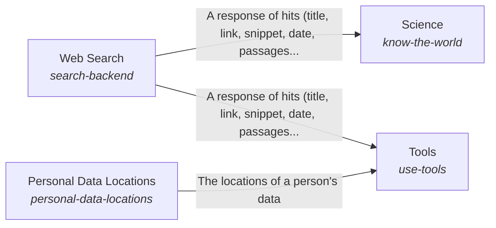

# Awareness of the outside and interaction with it

The AI knows what is outside the system and can interact with it: it brings in knowledge a reader can check and uses the right tool for each kind of need.

*ESOI records of this intent (evolvable structure that optimizes intent), generated from the CSV files beside this page by `esoi readmes`. Edit the CSV files, not this page.*

This sub-intent arises as the implementation `take-in-the-world:parts` of its parent intent [`hub-of-hubs`](../../esoi/README.md). Opportunities: Tool categories as solutions, with integrations as their implementations, and personal data locations resolved as a setup fact, go beyond bringing in a web search. A category can gain a better integration without any product rewriting its code.

## How the solutions fit together

World is how the system learns what is outside it and acts on it. Science looks up what the research literature says and returns observations a reader can cite. Tools groups what the AI can use by category and reaches the web through Web Search and the places a person keeps personal data through Personal Data Locations.

## Diagram

An arrow runs from the solution that provides to the solution that builds on it; its label is what the provider outputs.

## Solutions at a glance

| Solution | Handle | Entry call | Selected implementation | Metric |
|---|---|---|---|---|
| Science | `know-the-world` | `hubofhubs.run("know-the-world", 'meditation and attention')` | OpenAlex semantic search (`openalex_semantic`) | Research question finds its paper |
| Web Search | `search-backend` | `hubofhubs.run("search-backend", 'latest Rust release')` | Gemini grounding (`gemini`) | Search finds the source |
| Tools | `use-tools` | no entry declared | Categories of tools (`composition`) | The best integration of each category is chosen |
| Personal Data Locations | `personal-data-locations` | no entry declared | none selected | A location is declared once and found by every tool |

## Problems and ideals

**Problems**

- Each product wires its own integrations and finds a person's data its own way, so a new kind of integration means new code and a person's data locations are asked for again by every product. (`hprob-each-product-wires-its-own-tools`)
- A factual or research answer cites a web page instead of the papers and data that bear on it, so the reader cannot check it. (`hprob-claims-without-checkable-sources`)

**Ideals**

- Tools chosen by category (`hideal-tools-chosen-by-category`): For each category of tool, the best integration is chosen by measurement, and a person's data locations are declared once.

## Metrics and their leaders

- Research question finds its paper (`metric-know-the-world`): leader `openalex_semantic`, 52 of 150 cases
- Search finds the source (`metric-search-backend`): leader `gemini`, 32 of 40 cases
- The best integration of each category is chosen (`metric-use-tools`)
- A location is declared once and found by every tool (`metric-personal-data-locations`)

## Where to go next

- Parent intent: [The best parts for AI intelligence, assembled and proven](../../esoi/README.md)
- Repository: [top README](../../README.md)
- Records: [intent.csv](intent.csv), [problems.csv](problems.csv), [ideals.csv](ideals.csv), [solutions.csv](solutions.csv), [implementations.csv](implementations.csv), [metrics.csv](metrics.csv)
- Diagram page: [diagram.md](diagram.md)

---

## The full record

### Problems

- Each product wires its own integrations and finds a person's data its own way, so a new kind of integration means new code and a person's data locations are asked for again by every product. (`hprob-each-product-wires-its-own-tools`)
- A factual or research answer cites a web page instead of the papers and data that bear on it, so the reader cannot check it. (`hprob-claims-without-checkable-sources`)

### Ideals

- Tools chosen by category (`hideal-tools-chosen-by-category`): For each category of tool, the best integration is chosen by measurement, and a person's data locations are declared once.

### Solutions

| Solution | Handle | Selected | Metric |
|---|---|---|---|
| Science | `know-the-world` | OpenAlex semantic search (`openalex_semantic`) | Research question finds its paper |
| Web Search | `search-backend` | Gemini grounding (`gemini`) | Search finds the source |
| Tools | `use-tools` | Categories of tools (`composition`) | The best integration of each category is chosen |
| Personal Data Locations | `personal-data-locations` | none selected | A location is declared once and found by every tool |

### Implementations

| Implementation | Handle | Where | Sub-intent |
|---|---|---|---|
| OpenAlex keyword search | `know-the-world:openalex` | [hubofhubs/science/openalex.py](../science/openalex.py) |  |
| OpenAlex semantic search | `know-the-world:openalex_semantic` | [hubofhubs/science/openalex_semantic.py](../science/openalex_semantic.py) |  |
| OpenAlex keywords, rule rewrite | `know-the-world:openalex_keywords` | [hubofhubs/science/openalex_keywords.py](../science/openalex_keywords.py) |  |
| OpenAlex keywords, model rewrite | `know-the-world:openalex_keywords_model` | [hubofhubs/science/openalex_keywords.py](../science/openalex_keywords.py) |  |
| Semantic and web paper search | `know-the-world:openalex_semantic_and_web` | [hubofhubs/science/openalex_semantic_and_web.py](../science/openalex_semantic_and_web.py) |  |
| Brave Search API | `search-backend:brave` | [hubofhubs/websearch/backends.py](../websearch/backends.py) |  |
| Gemini grounding | `search-backend:gemini` | [hubofhubs/websearch/gemini.py](../websearch/gemini.py) |  |
| Provider-native search | `search-backend:provider` | [hubofhubs/websearch/backends.py](../websearch/backends.py) |  |
| SearXNG metasearch | `search-backend:searxng` | [hubofhubs/websearch/backends.py](../websearch/backends.py) |  |
| Serper Google search | `search-backend:serper` | [hubofhubs/websearch/backends.py](../websearch/backends.py) |  |
| Tavily search API | `search-backend:tavily` | [hubofhubs/websearch/backends.py](../websearch/backends.py) |  |
| Web research | `know-the-world:web_research` | [hubofhubs/websearch/research.py](../websearch/research.py) |  |
| Categories of tools | `use-tools:composition` |  |  |

### Metrics

- Research question finds its paper (`metric-know-the-world`): `esoi run know_the_world --impl openalex_semantic_and_web; esoi run know_the_world --impl openalex_semantic; esoi run know_the_world --impl web_research; esoi run know_the_world --impl openalex; esoi run know_the_world --impl openalex_keywords; esoi run know_the_world --impl openalex_keywords_model`
- Search finds the source (`metric-search-backend`): `esoi run search_backend --impl gemini; esoi run search_backend --impl provider; esoi run search_backend --impl searxng; esoi run search_backend --impl brave; esoi run search_backend --impl serper; esoi run search_backend --impl tavily`
- The best integration of each category is chosen (`metric-use-tools`): `none`
- A location is declared once and found by every tool (`metric-personal-data-locations`): `none`
