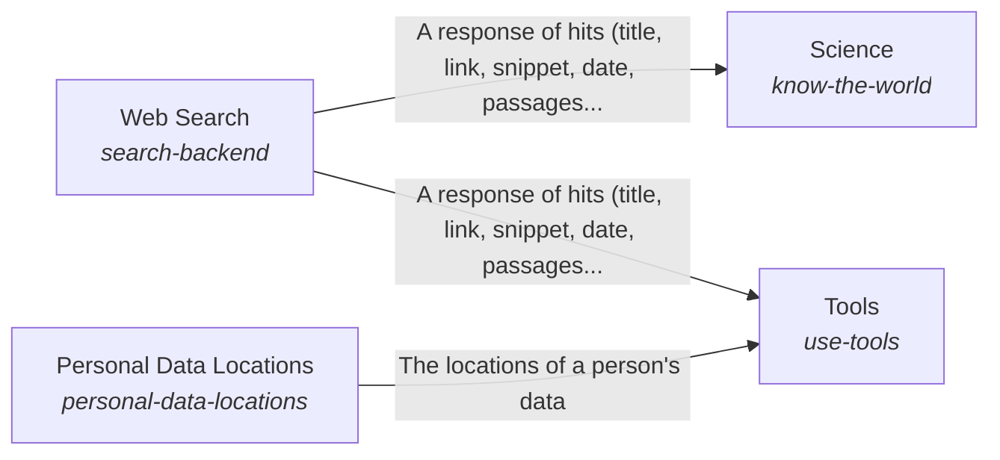

These are ESOI records rendered as a diagram (evolvable structure that optimizes intent). This page is generated from the solutions' outputs and the implementations' `uses_solution_ids` by `esoi diagram`; edit those records, not this page.

# Solution diagram: Awareness of the outside and interaction with it

World is how the system learns what is outside it and acts on it. Science looks up what the research literature says and returns observations a reader can cite. Tools groups what the AI can use by category and reaches the web through Web Search and the places a person keeps personal data through Personal Data Locations.

An arrow runs from the solution that provides to the solution that builds on it; its label is what the provider outputs.

