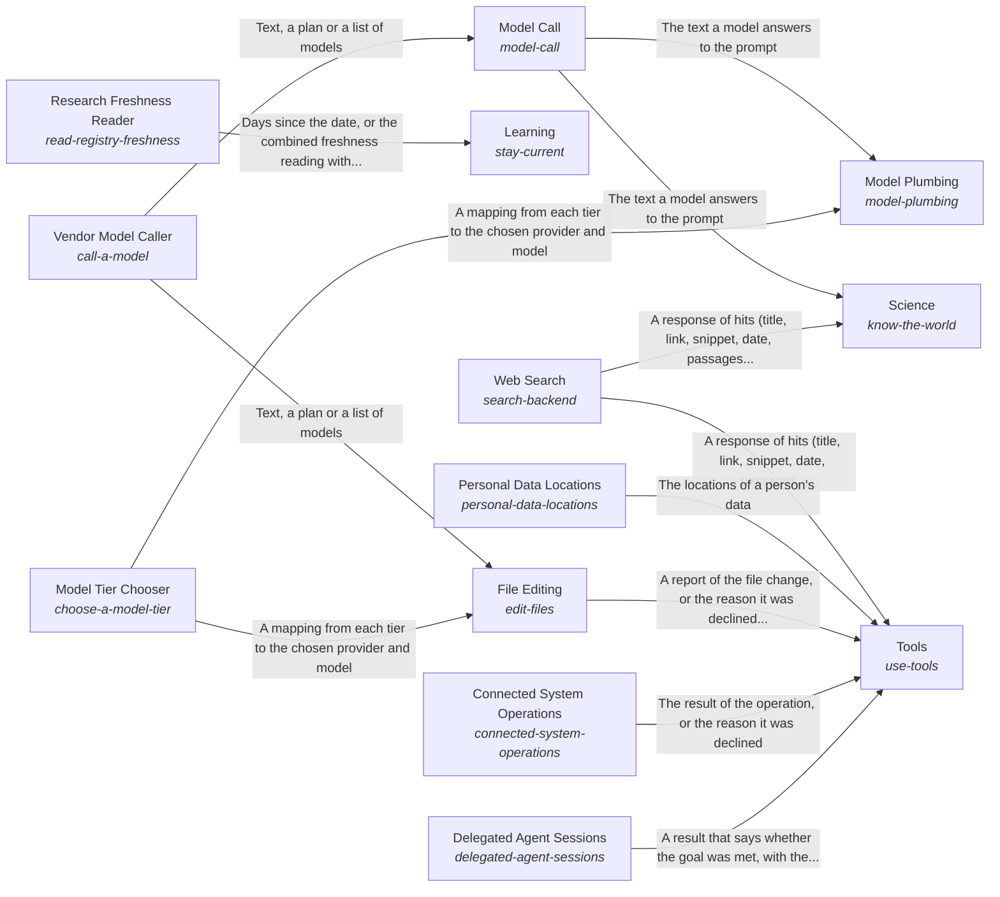

These are ESOI records rendered as a diagram (evolvable structure that optimizes intent). This page is generated from the solutions' outputs and the implementations' `uses_solution_ids` by `esoi diagram`; edit those records, not this page.

# Solution diagram: Awareness of the outside and interaction with it

World is how the system learns what is outside it and acts on it. Science returns observations of public research that a reader can cite. Tools lets the AI use the tool of a category through Web Search, File Editing, Connected System Operations, Delegated Agent Sessions or Personal Data Locations. File Editing makes its one-call edit through Vendor Model Caller at the tier that Model Tier Chooser picks. Model Plumbing is how every part asks a model, and it picks the model for each tier through Model Tier Chooser and asks that model through Model Call. Model Call reaches each vendor through Vendor Model Caller, which steps to the next provider when one fails. Learning keeps the research current by reading dates through Research Freshness Reader.

An arrow runs from the solution that provides to the solution that builds on it; its label is what the provider outputs.

