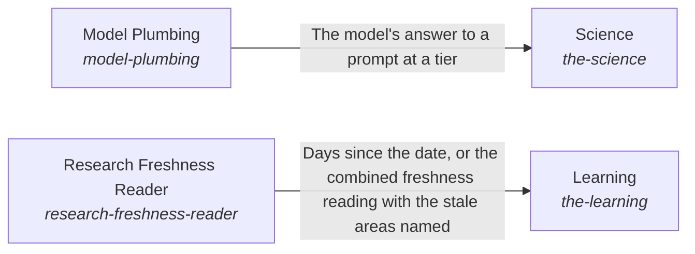
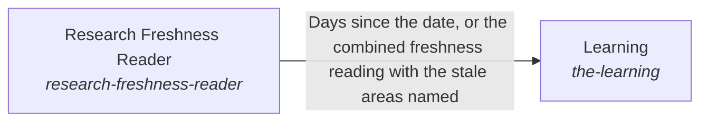

# Learning

*ESOI records kept beside the code in `hubofhubs/the_world/learning`, generated from the CSV files in this folder by `esoi readmes`. Edit the CSV files, not this page.*

The AI knows what is outside the system and can interact with it: it brings in knowledge a reader can check, uses the right tool for each kind of need, asks a model through one measured path and keeps its own research current.

These are the solutions of [Awareness of the outside and interaction with it](../README.md).

## How the solutions fit together

World is how the system learns what is outside it and acts on it. Science returns observations of public research that a reader can cite. Tools lets the AI use the tool of a category through Web Search, File Reading, File Editing, Connected System Operations or Delegated Agent Sessions, and refuses a category the authority does not allow. File Editing makes its one-call edit through Vendor Model Caller at the tier that Model Tier Chooser picks. Model Plumbing is how every part asks a model, through Model Tier Chooser and Vendor Model Caller. Vendor Model Caller steps to the next provider when one fails. Learning keeps the research current by reading dates through Research Freshness Reader.

## Overview diagram

An arrow runs from the solution that provides to the solution that builds on it; its label is what the provider outputs.

## Learning (`the-learning`)

Keep what the hub recommends current with the outside.

- Entry call: `hubofhubs.run("the-learning", '2026-11-03')`
- Selected implementation: Stale areas from the registry dates (`registry_research`)
- Metric: Days since each seat was researched, Public stage sourced and triangulated, Best in circumstance with variants
- Implemented by: [`hubofhubs/the_world/__init__.py`](../__init__.py), [`hubofhubs/the_world/flow.py`](../flow.py), [`hubofhubs/the_world/interface.py`](../interface.py), [`hubofhubs/the_world/learning/__init__.py`](__init__.py), [`hubofhubs/the_world/learning/interface.py`](interface.py), [`hubofhubs/the_world/learning/registry_research.py`](registry_research.py), [`hubofhubs/the_world/learning/research_freshness_reader/__init__.py`](research_freshness_reader/__init__.py), [`hubofhubs/the_world/learning/research_freshness_reader/interface.py`](research_freshness_reader/interface.py) and 120 more

## Diagram

An arrow runs from the solution that provides to the solution that builds on it; its label is what the provider outputs.

## Implementations

| Implementation | Handle | Code | Selected |
|---|---|---|---|
| Stale areas from the registry dates | `the-learning:registry_research` | [`hubofhubs/the_world/learning/registry_research.py`](registry_research.py) | selected |

## Metrics

- Days since each seat was researched (`metric-the-learning`)
- Public stage sourced and triangulated (`metric-public-stage-sourced-and-triangulated`)
- Best in circumstance with variants (`metric-best-in-circumstance-with-variants`)

## Where to go next

- Up: [hubofhubs](../../README.md)
- Intent: [Awareness of the outside and interaction with it](../README.md)
- Down: [hubofhubs/the_world/learning/research_freshness_reader](research_freshness_reader/README.md)
- Repository: [top README](../../../README.md)
