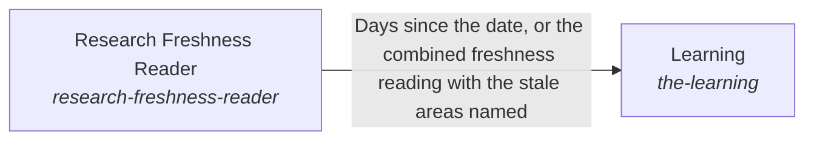

# Learning

**Purpose:** Keep what the hub recommends current with the outside.

Breadcrumb: [Top](../../../esoi/README.md) > [Awareness of the outside and interaction with it](../README.md) > Learning

Part of [Awareness of the outside and interaction with it](../README.md)

## Learning (`the-learning`)

- Out of scope: Judging whether a recommendation is still best (the metric of each solution does that), and acting on a finding (the applied part names what changes; the owner of the record changes it).
- Delegates to: research-freshness-reader, web-search, the-science
- Entry call: `hubofhubs.run("the-learning", '2026-11-03')`
- Selected implementation: Systematic review (`systematic_review`)
- Metric: Research kept current and done as a review, Public stage sourced and triangulated, Best in circumstance with variants, Research recorded and reused
- Implemented by: [`hubofhubs/the_world/__init__.py`](../__init__.py), [`hubofhubs/the_world/flow.py`](../flow.py), [`hubofhubs/the_world/interface.py`](../interface.py), [`hubofhubs/the_world/learning/__init__.py`](__init__.py), [`hubofhubs/the_world/learning/interface.py`](interface.py), [`hubofhubs/the_world/learning/investigation_record.py`](investigation_record.py), [`hubofhubs/the_world/learning/investigation_store.py`](investigation_store.py), [`hubofhubs/the_world/learning/recorded_research.py`](recorded_research.py) and 202 more

## One level below

- [Research Freshness Reader](research_freshness_reader/README.md) (solution with implementations): Read the registry's recorded dates and report how old each area's research is.

## Diagram

An arrow runs from the solution that provides to the solution that builds on it; its label is what the provider outputs.

## Implementations

| Implementation | Handle | Purpose | Code | Selected |
|---|---|---|---|---|
| Stale areas and one search | `the-learning:registry_research` | Lists the areas whose last research is older than the ninety day bar, and, asked for a review, runs one search through The Science and lists the hits as they came: no protocol, no screening, no counts, no grades, no decisions. | [`hubofhubs/the_world/learning/registry_research.py`](registry_research.py) |  |
| Systematic review | `the-learning:systematic_review` | Does a knowledge search as a small systematic review sized to the decision, searches through Web Search and The Science, and returns the investigation record: protocol, queries with dates, counted screening, graded items, synthesis, decisions, the applied part and a revisit date. Reports what learning is due. | [`hubofhubs/the_world/learning/systematic_review.py`](systematic_review.py) | selected |
| Recorded and reused research | `the-learning:recorded_research` | Does the systematic review behind a memory in the structure: before searching it finds the earlier investigations linked to the solutions the request serves (and the ones above them), reuses a fresh one with its date and limits cited, or searches only the gap of a stale or smaller one and updates the same investigation in place; after searching it records the investigation through a store the consumer supplies, adds each kept finding as a knowledge item of the solution it informs (once, never over a person's text, held as proposed where the location holds it for a person) and puts one scope-fenced context item per investigation. A question that informs no decision is a quick fact: not looked up, not recorded. | [`hubofhubs/the_world/learning/recorded_research.py`](recorded_research.py) |  |

## Metrics

- Research kept current and done as a review (`metric-the-learning`): leader `systematic_review`, 30 of 30 cases
- Public stage sourced and triangulated (`metric-public-stage-sourced-and-triangulated`)
- Best in circumstance with variants (`metric-best-in-circumstance-with-variants`)
- Research recorded and reused (`metric-research-recorded-and-reused`): leader `recorded_research`, 33 of 33 cases

## Where to go next

- Up: [hubofhubs](../../README.md)
- Intent: [Awareness of the outside and interaction with it](../README.md)
- Down: [hubofhubs/the_world/learning/research_freshness_reader](research_freshness_reader/README.md)
- Repository: [top README](../../../README.md)

*Generated from the CSV files in this folder by `esoi readmes`. Edit the CSV files, not this page.*
