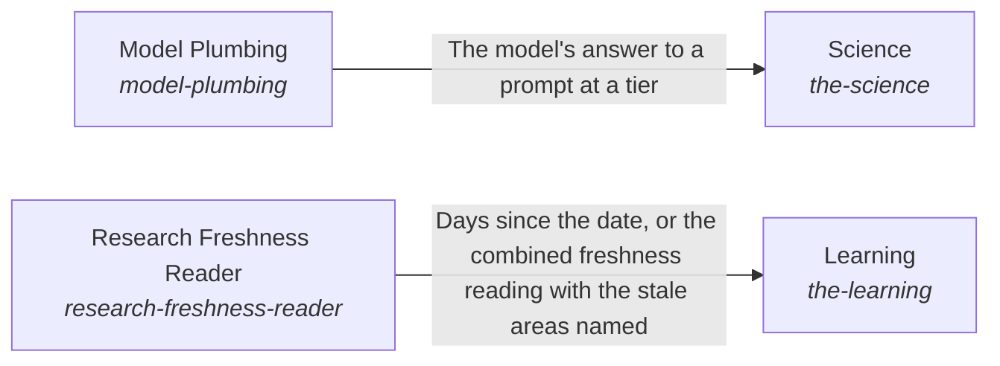

# Research Freshness Reader

*ESOI records kept beside the code in `hubofhubs/the_world/learning/research_freshness_reader`, generated from the CSV files in this folder by `esoi readmes`. Edit the CSV files, not this page.*

The AI system optimally learns and interacts with the world outside of it.

These are the solutions of [Awareness of the outside and interaction with it](../../README.md).

## How the solutions fit together

World is how the system learns what is outside it and acts on it. Science returns observations of public research that a reader can cite. Tools lets the AI use the tool of a category through Web Search, File Reading, File Editing, Connected System Operations or Delegated Agent Sessions, and refuses a category the authority does not allow. File Editing makes its one-call edit through Vendor Model Caller at the tier that Model Tier Chooser picks. Model Plumbing is how every part asks a model, through Model Tier Chooser and Vendor Model Caller. Vendor Model Caller steps to the next provider when one fails. Learning keeps the research current by reading dates through Research Freshness Reader.

## Overview diagram

An arrow runs from the solution that provides to the solution that builds on it; its label is what the provider outputs.

## Research Freshness Reader (`research-freshness-reader`)

Read the registry's recorded dates and report how old each area's research is.

- Entry call: `hubofhubs.run("research-freshness-reader", '2026-10-01')`
- Selected implementation: Registry date scan (`registry_scan`)
- Metric: Registry freshness reading
- Implemented by: [`docs/explanation/compared.md`](../../../../docs/explanation/compared.md), [`docs/explanation/glossary.md`](../../../../docs/explanation/glossary.md), [`docs/explanation/how-we-measure.md`](../../../../docs/explanation/how-we-measure.md), [`docs/explanation/layout-of-the-hub.md`](../../../../docs/explanation/layout-of-the-hub.md), [`docs/explanation/public-evidence.md`](../../../../docs/explanation/public-evidence.md), [`docs/explanation/resolution-design.md`](../../../../docs/explanation/resolution-design.md), [`docs/explanation/science-search.md`](../../../../docs/explanation/science-search.md), [`docs/explanation/terminal-harness.md`](../../../../docs/explanation/terminal-harness.md) and 179 more

## Implementations

| Implementation | Handle | Code | Selected |
|---|---|---|---|
| Registry date scan | `research-freshness-reader:registry_scan` | [`hubofhubs/the_world/learning/research_freshness_reader/registry.py`](registry.py) | selected |

## Metrics

- Registry freshness reading (`metric-research-freshness-reader`): leader `registry_scan`, 41 of 41 cases

## Problems

- Research dates read by hand (`hprob-research-dates-are-read-by-hand`): How old each area's research is has to be worked out by hand, so stale recommendations go unnoticed.

## Where to go next

- Up: [hubofhubs/the_world/learning](../README.md)
- Intent: [Awareness of the outside and interaction with it](../../README.md)
- Repository: [top README](../../../../README.md)
